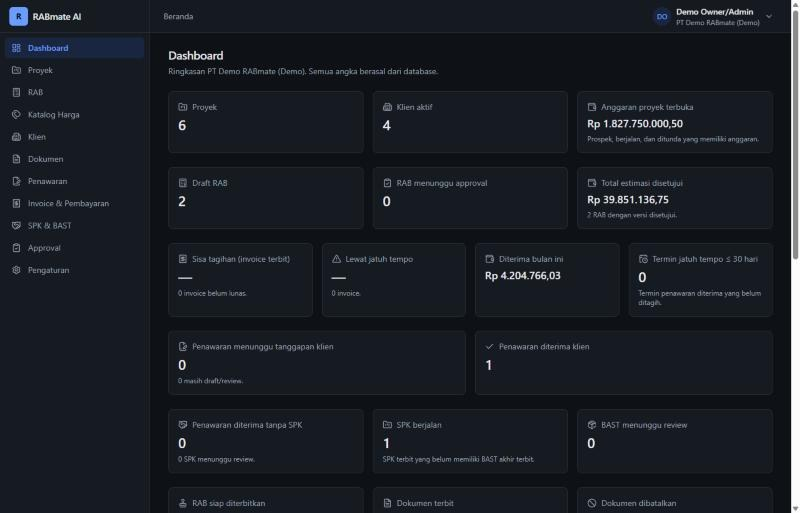
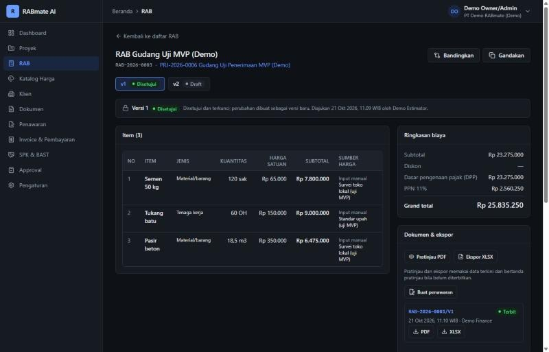
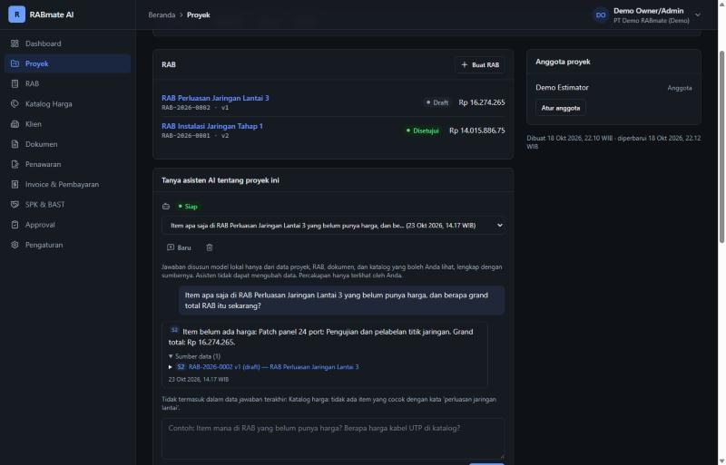
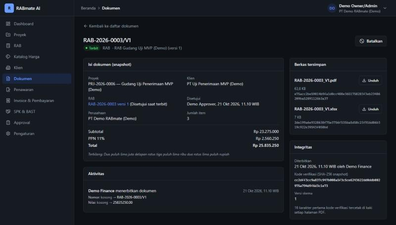
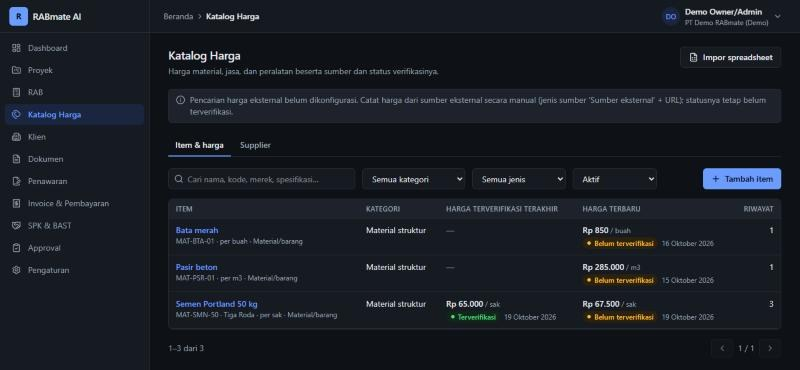
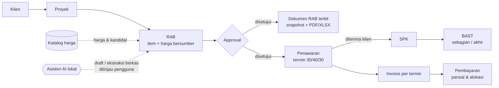
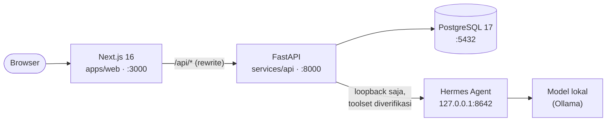

<div align="center">

# RABmate AI

**Susun RAB, kelola harga bersumber, dan terbitkan dokumen proyek — dibantu AI yang berjalan sepenuhnya di komputer Anda.**

[](services/api)
[](services/api)
[](apps/web)
[](docker-compose.yml)
[-8A2BE2)](docs/LOCAL_DEVELOPMENT.md#7-ai-lokal-hermes-agent--model-lokal--fase-8)
[](#pengujian)
[](docs/PROJECT_PLAN.md#6-kriteria-mvp-selesai)

[Fitur](#fitur) · [Tangkapan layar](#tangkapan-layar) · [Alur kerja](#alur-kerja) · [Mulai cepat](#mulai-cepat) · [Akun demo](#akun-demo) · [Dokumentasi](#dokumentasi)



</div>

---

## Tentang

RABmate AI membantu tim estimasi, proyek, dan keuangan menyusun **Rencana Anggaran Biaya (RAB)**
dan dokumen turunannya — penawaran, invoice, SPK, BAST — untuk berbagai jenis proyek: konstruksi,
fabrikasi, pengadaan, IT, jasa profesional, dan lainnya.

Tiga prinsip yang dipegang di seluruh aplikasi:

- **Angka dihitung server, bukan diketik ulang.** Total, pajak, diskon, termin, dan sisa tagihan
  dihitung backend dengan `Decimal`; dokumen yang terbit dibekukan sebagai snapshot + SHA-256.
- **Setiap harga punya sumber.** Harga katalog menyimpan pemasok/referensi dan status verifikasi;
  harga tanpa sumber tidak pernah dianggap terverifikasi.
- **AI hanya membantu, manusia yang memutuskan.** Asisten berjalan lokal (Hermes Agent + Ollama,
  tanpa fallback cloud), hanya membaca data lewat tool read-only, dan tidak pernah mengubah RAB atau
  menerbitkan dokumen tanpa tinjauan pengguna.

## Fitur

| Modul | Yang bisa dilakukan |
|---|---|
| **RAB engine** | Item material/jasa/upah/peralatan, volume & harga desimal, pajak & diskon, validasi (item tanpa harga, harga belum terverifikasi), versi, perbandingan versi, approval, ekspor XLSX, impor dari spreadsheet |
| **Katalog harga** | Riwayat harga per item dengan pemasok & referensi, verifikasi oleh approver, impor spreadsheet, saran kandidat harga saat mengisi RAB |
| **Dokumen** | Pratinjau PDF dari data terkini, penerbitan idempoten dengan nomor resmi, snapshot beku + berkas PDF/XLSX tersimpan, kode verifikasi di setiap halaman, template per organisasi |
| **Penawaran & invoice** | Penawaran dari RAB disetujui dengan termin (persen/nominal), respons klien, invoice per termin atau manual, pembayaran parsial dengan alokasi dan sisa tagihan |
| **SPK & BAST** | SPK dari penawaran yang diterima, BAST sebagian/akhir dengan kontrol volume kumulatif terhadap kontrak |
| **Asisten AI lokal** | Draft item RAB dari deskripsi, ekstraksi item dari teks atau **berkas PDF/XLSX/CSV** (OCR opsional) dengan rujukan halaman & baris, **chat proyek** yang menjawab dari data proyek/RAB/katalog dengan kutipan sumber dan peringatan otomatis |
| **Tata kelola** | 6 peran (Owner, Project Manager, Estimator, Finance, Approver, Viewer), isolasi data per organisasi, audit log, dashboard ringkasan |

## Tangkapan layar

<table>
  <tr>
    <td width="50%"><br><sub><b>Ruang kerja RAB</b> — versi, item bersumber, ringkasan biaya, dokumen terbit.</sub></td>
    <td width="50%"><br><sub><b>Chat proyek</b> — jawaban model lokal dengan kutipan sumber [S2] dan data yang dipakai.</sub></td>
  </tr>
  <tr>
    <td width="50%"><br><sub><b>Dokumen terbit</b> — snapshot beku, berkas tersimpan, hash integritas.</sub></td>
    <td width="50%"><br><sub><b>Katalog harga</b> — harga terverifikasi dan terbaru dipisahkan, lengkap dengan statusnya.</sub></td>
  </tr>
</table>

<sub>Semua tangkapan layar memakai data demo (berlabel "(Demo)").</sub>

## Alur kerja



Setiap perubahan setelah approval dibuat sebagai **versi baru**; dokumen yang sudah terbit tidak
pernah berubah.

## Arsitektur



Backend adalah satu-satunya sumber kebenaran untuk perhitungan, validasi, izin, dan status. Detail
di [ARCHITECTURE.md](docs/ARCHITECTURE.md) dan keputusan teknis di [DECISIONS.md](docs/DECISIONS.md).

| Lapisan | Teknologi |
|---|---|
| Frontend | Next.js 16 (App Router), React 19, TypeScript strict, Tailwind CSS 4, TanStack Query, React Hook Form + Zod, Vitest |
| Backend | FastAPI, SQLAlchemy 2.1, Alembic, Pydantic 2, psycopg 3, ReportLab (PDF), openpyxl (XLSX), pypdf, pytest |
| Database | PostgreSQL 17 (Docker) |
| AI | Hermes Agent (API server OpenAI-compatible) + Ollama, mis. `qwen2.5:3b`; Tesseract OCR opsional |

## Mulai cepat

**Prasyarat:** Windows 11 + PowerShell, Python 3.12+, Node.js 24+, Docker Desktop (berjalan).

```powershell
# 1. Sekali saja: .env, dependensi, database, migrasi
powershell -ExecutionPolicy Bypass -File scripts\setup.ps1

# 2. Isi data demo lengkap (opsional, khusus development)
cd services\api
.\.venv\Scripts\python.exe -m app.cli seed-demo
cd ..\..

# 3. Jalankan database + API + web
powershell -ExecutionPolicy Bypass -File scripts\dev.ps1
```

Buka <http://localhost:3000>. Tanpa data demo, buat admin pertama untuk organisasi Anda (kata sandi
diminta secara interaktif):

```powershell
cd services\api
.\.venv\Scripts\python.exe -m app.cli create-admin --email anda@perusahaan.co.id --name "Nama Anda" --organization "PT Anda"
```

Panduan lengkap, perintah manual, dan troubleshooting:
[LOCAL_DEVELOPMENT.md](docs/LOCAL_DEVELOPMENT.md).

## Akun demo

`seed-demo` membuat organisasi **PT Demo RABmate (Demo)** dengan satu akun per peran, lalu
menjalankan alur bisnis lengkap lewat API: katalog bersumber, RAB disetujui dengan dokumen terbit,
penawaran diterima, SPK & BAST, invoice yang dibayar sebagian, serta RAB yang menunggu approval.

| Email | Peran | Coba ini |
|---|---|---|
| `demo.owner@example.com` | Owner/Admin | Semua menu, pengaturan organisasi & pengguna, audit |
| `demo.project-manager@example.com` | Project Manager | Klien & proyek, SPK & BAST, chat proyek |
| `demo.estimator@example.com` | Estimator | Menyusun RAB, katalog harga, asisten AI |
| `demo.approver@example.com` | Approver | Menyetujui RAB & dokumen, verifikasi harga |
| `demo.finance@example.com` | Finance | Menerbitkan dokumen, invoice, pembayaran |
| `demo.viewer@example.com` | Viewer | Melihat saja |

Semua akun memakai **satu kata sandi acak** yang dibuat saat seed dan disimpan di
`var/demo-credentials.txt`. Berkas itu di-`.gitignore` dan tidak ikut ke repository. Data demo
ditolak di `APP_ENV=production`.

## AI lokal (opsional)

Fitur non-AI berjalan penuh tanpa AI. Untuk mengaktifkan asisten, pasang Ollama dan Hermes Agent
dengan profil khusus RABmate (tanpa toolset terminal/file/web), lalu setel `AI_ENABLED=true` dan
`HERMES_API_KEY` di `.env`. Langkah, kebutuhan perangkat, dan hasil uji dengan `qwen2.5:3b` ada di
[LOCAL_DEVELOPMENT §7](docs/LOCAL_DEVELOPMENT.md#7-ai-lokal-hermes-agent--model-lokal--fase-8).

> Dengan model kecil (3B), ekstraksi tabel dari berkas layak dipakai dengan tinjauan; chat berguna
> untuk pertanyaan faktual sederhana. Setiap jawaban diperiksa kode (kutipan, angka, klaim
> verifikasi) dan ditandai bila meragukan.

## Pengujian

```powershell
powershell -ExecutionPolicy Bypass -File scripts\check.ps1
```

Menjalankan ruff, mypy strict, pytest (513 tes, termasuk **tes penerimaan MVP 11 langkah**, alur
demo, migrasi per langkah, isolasi organisasi, dan keamanan), ESLint, TypeScript, Vitest (167 tes),
serta `next build`. Tes AI memakai adapter palsu, sehingga **tidak membutuhkan model lokal**.

## Struktur repository

```
apps/web/            Next.js: halaman, komponen per modul, klien API (+CSRF), validasi form
services/api/
  app/core/          konfigurasi, logging teredaksi, error, keamanan, rate limit
  app/ai/            adapter Hermes, parsing jawaban & angka
  app/modules/       identity, clients, projects, rab, pricing, documents, billing,
                     workorders, intake, assistant, audit, dashboard, numbering
  app/cli.py         create-admin, set-password, seed-demo (+ app/demo_story.py)
  alembic/           migrasi database
  tests/             pytest (unit, API, penerimaan, migrasi)
docs/                rencana, arsitektur, keputusan, API, database, keamanan, deployment
scripts/             setup.ps1, dev.ps1, check.ps1
docker-compose.yml   PostgreSQL 17 (bind 127.0.0.1)
.env.example         semua konfigurasi (placeholder, tanpa secret)
```

## Keamanan

- Sesi server-side (cookie `HttpOnly`) + token CSRF + cek `Origin`; kata sandi Argon2id; throttle
  login.
- Setiap query memfilter organisasi; objek organisasi lain selalu `404`. Izin dicek di backend untuk
  setiap endpoint.
- Unggahan diperiksa dari isinya (bukan nama berkas), rumus spreadsheet tidak pernah dihitung, teks
  pengguna tidak pernah diekspor sebagai formula.
- Endpoint berat dibatasi per pengguna; CSP, HSTS (production), dan guard konfigurasi production.
- `.env` dan `var/` tidak pernah di-commit; `.env.example` hanya berisi placeholder.

Hasil tinjauan keamanan: [SECURITY.md](docs/SECURITY.md).

## Dokumentasi

| Dokumen | Isi |
|---|---|
| [PROJECT_PLAN.md](docs/PROJECT_PLAN.md) | Rencana, ringkasan tiap fase, kriteria MVP |
| [ARCHITECTURE.md](docs/ARCHITECTURE.md) | Arsitektur, alur data, workflow AI, keamanan ringkas |
| [DECISIONS.md](docs/DECISIONS.md) | Catatan keputusan teknis (ADR-001 s.d. ADR-047) |
| [API.md](docs/API.md) | Endpoint REST `/api/v1` beserta izinnya |
| [DATABASE.md](docs/DATABASE.md) | Skema, relasi, constraint, migrasi |
| [LOCAL_DEVELOPMENT.md](docs/LOCAL_DEVELOPMENT.md) | Setup lokal, data demo, AI lokal, OCR, troubleshooting |
| [SECURITY.md](docs/SECURITY.md) | Kontrol keamanan, hasil pemeriksaan, risiko yang diterima |
| [DEPLOYMENT.md](docs/DEPLOYMENT.md) | Checklist deployment, uji asap, rollback |

## Status

**MVP selesai** — 17 kriteria MVP terpenuhi dan teruji
([PROJECT_PLAN §6](docs/PROJECT_PLAN.md#6-kriteria-mvp-selesai)). Belum di-deploy ke server publik.

Batasan yang diketahui: OCR (Tesseract) belum dipasang di lingkungan pengembangan; belum ada MFA
atau reset kata sandi lewat email; rate limit dan background task AI berada di memori satu proses
API. Detail di [DEPLOYMENT.md](docs/DEPLOYMENT.md#6-batasan-operasional-yang-diketahui).
