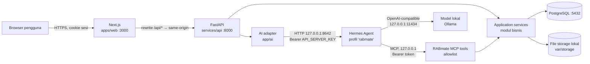
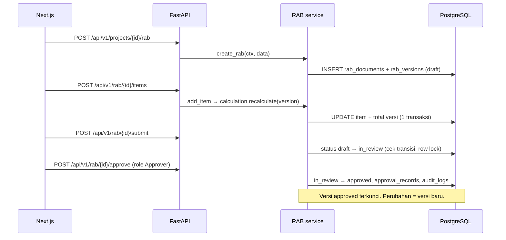
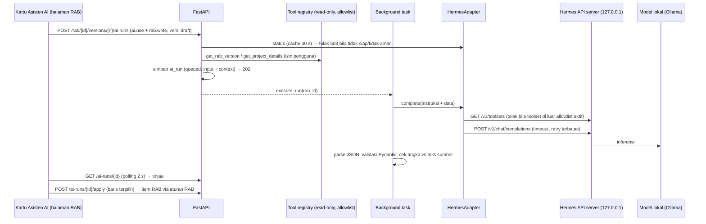
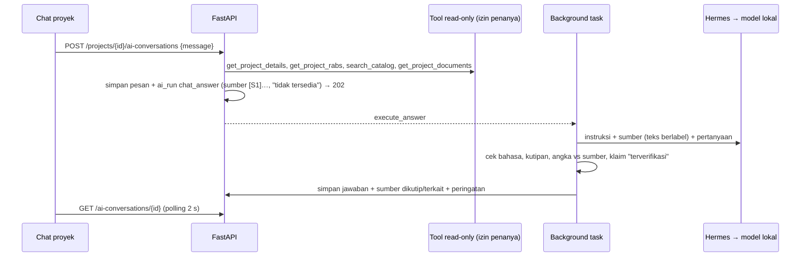

# RABmate AI — Arsitektur

## 1. Gambaran umum



Prinsip:

- **Backend adalah satu-satunya sumber kebenaran** untuk perhitungan, validasi, status, dan izin.
- Browser hanya bicara dengan Next.js. Next.js meneruskan `/api/*` ke FastAPI (rewrite), sehingga
  cookie sesi bersifat first-party dan CORS tidak dibutuhkan untuk jalur browser.
- Hermes **tidak** pernah menyentuh database. Ia hanya dapat memanggil tools RABmate yang di-allowlist,
  dan tools tersebut memanggil service yang sama dengan API biasa (izin & validasi yang sama).
- Semua service AI, model, dan MCP hanya bind ke `127.0.0.1`.

## 2. Lapisan backend

```
services/api/app/
├── main.py              # app factory, middleware, error handler, router /api/v1
├── core/                # config (pydantic-settings), logging, errors, security util
├── db/                  # engine, session, Base, mixin (timestamps, UUID PK)
├── api/v1/              # router agregat; tiap modul punya router sendiri
├── modules/<modul>/     # models.py, schemas.py, service.py, router.py, (calculation.py)
└── ai/                  # adapter Hermes, fake adapter, tools, guardrails
```

Aturan dependensi: `router → service → models/db`. Router tidak menulis query langsung; service
tidak mengenal HTTP. Fungsi kalkulasi (`rab/calculation.py`) adalah fungsi murni tanpa I/O
sehingga mudah diuji dan dipakai ulang oleh tools AI.

## 3. Multi-tenant & otorisasi

- Setiap entitas bisnis memiliki `organization_id`.
- Konteks request (`RequestContext`: user, organisasi aktif, permission) dibentuk sekali dari sesi.
- Semua query service menerima konteks dan **selalu** memfilter `organization_id`, termasuk
  detail, update, delete, ekspor, dan unduh file. Objek milik organisasi lain → `404` (bukan `403`)
  agar keberadaan objek tidak bocor.
- Permission berbentuk string (`rab.read`, `rab.approve`, …). Role adalah kumpulan permission.
  Pemeriksaan dilakukan di backend via dependency FastAPI; frontend hanya menyembunyikan UI.

## 4. Alur data utama

### 4.1 Membuat & menyetujui RAB



### 4.2 Penerbitan dokumen (snapshot)

Diimplementasikan di Fase 5 (`app/modules/documents`, ADR-030–032):

1. Klien mengirim `POST /rab/{id}/versions/{n}/documents` dengan header `Idempotency-Key`.
2. Service mengunci versi (`SELECT … FOR UPDATE`); kunci yang sudah dipakai → kembalikan dokumen
   yang sama; versi harus `approved` dan belum punya dokumen berlaku.
3. Total dihitung ulang dan dicocokkan; data diserialisasi menjadi snapshot JSON (`snapshot.py`)
   dengan hash SHA-256; nomor `<nomor RAB>/V<n>` (`-R<k>` setelah pembatalan).
4. PDF (`render_pdf.py`) dan XLSX (`render_xlsx.py`) dirender dari snapshot — bukan dari tabel
   hidup — dan disimpan di `document_files` dalam transaksi yang sama.
5. Unduhan menyajikan byte tersimpan; pratinjau memakai builder snapshot yang sama tanpa menyimpan.

Penawaran dan invoice (Fase 6) serta SPK dan BAST (Fase 7) memakai mekanisme yang sama lewat
`documents.service.store_document`: entitas sumber dikunci, status/izin dicek, nomor diberikan (SPK,
BAST, invoice: saat terbit), snapshot diperiksa ulang terhadap sumbernya (nilai kontrak = penawaran;
volume BAST kumulatif ≤ kontrak di bawah kunci SPK), lalu PDF dirender sekali dan disimpan.
Pembatalan dokumen non-RAB dilakukan dari endpoint sumbernya agar status bisnis ikut berubah dan
ketergantungan (invoice, pembayaran, SPK, BAST) dicek.

### 4.3 Workflow AI (Fase 8, mode `structured`)



Data yang dikirim ke model terbatas pada data proyek dan nama/volume/satuan item RAB, plus
deskripsi atau teks dokumen dari pengguna. Harga RAB tidak dikirim.

AI tidak mengubah data bisnis. Kegagalan model hanya menandai run `failed`.

Mode `agentic` (Hermes memanggil tool via MCP) ditunda ke fase berikutnya (ADR-040). Registry
tool yang sama menjadi kontraknya, dengan *grant* berumur pendek seperti rancangan awal.

### 4.4 Dokumen sumber & chat proyek (Fase 9)

- **Dokumen sumber** (ADR-043): unggah → deteksi jenis dari isi → simpan per proyek (dedup
  SHA-256) → saat diekstrak, dibaca sekali di latar belakang (pypdf/openpyxl/CSV, OCR Tesseract
  bila terpasang) → baris bernomor lintas halaman → dibagi per bagian → tiap bagian lewat aturan
  deterministik Fase 8 → tinjau → terapkan. Isi dokumen tidak pernah dieksekusi (rumus tidak
  dihitung, instruksi di dalamnya hanya data).
- **Chat proyek** (ADR-044): pertanyaan → backend mengambil data lewat tool read-only dengan izin
  penanya (proyek, RAB, katalog, dokumen) → sumber bernomor `[S1]…` → model lokal → pemeriksaan
  kutipan, angka, klaim verifikasi, bahasa → jawaban + sumber + peringatan disimpan di percakapan
  privat. Tidak ada tool tulis; jawaban hanya saran.



## 5. Keamanan ringkas

| Ancaman | Kontrol |
|---|---|
| Pencurian sesi | Cookie `HttpOnly`, `SameSite=Lax`, `Secure` di produksi; token sesi disimpan sebagai hash di DB |
| CSRF | Token CSRF double-submit untuk metode non-GET + cek `Origin` |
| IDOR / lintas organisasi | Filter `organization_id` di setiap query service; tes isolasi |
| SQL injection | ORM/parameterized query saja; AI tidak bisa menjalankan SQL |
| Upload berbahaya | Batas ukuran (dibaca terbatas), jenis dari isi file + ekstensi harus cocok, batas zip bomb XLSX, nama file hanya tampilan, isi di PostgreSQL (tanpa path), unduh `attachment` + `nosniff`; rumus/instruksi di dokumen tidak dieksekusi |
| Formula injection | Escape nilai diawali `= + - @ \t \r` saat ekspor CSV/XLSX |
| Agent berlebihan hak | Profil Hermes tanpa toolset bawaan; MCP `tools.include`; bind 127.0.0.1 |
| Penyalahgunaan endpoint berat | Rate limit per pengguna untuk PDF/XLSX, penerbitan, unggahan/impor, dan AI → 429 (ADR-046) |
| Framing / konten aktif | CSP halaman (`frame-ancestors`, `object-src`, `base-uri`, `form-action`), CSP `default-src 'none'` untuk JSON API, HSTS di production |
| Salah konfigurasi production | Start ditolak bila `SECRET_KEY` lemah, CORS bukan `https://`, atau cookie sesi tidak Secure |
| Kebocoran di log | Logging terstruktur dengan redaksi field sensitif; isi dokumen & prompt tidak dicatat |

## 6. Infrastruktur lokal

| Komponen | Cara jalan | Port |
|---|---|---|
| PostgreSQL 17 | Docker Compose (`db`) | 5432 |
| FastAPI | `uvicorn` dari venv lokal (atau Compose profil `app` nanti) | 8000 |
| Next.js | `npm run dev` | 3000 |
| Hermes Agent | Proses terpisah di host, `HERMES_HOME` khusus RABmate (opsional) | 8642 |
| Ollama | Proses host (opsional) | 11434 |

Redis/queue belum dipakai. Pekerjaan berat (impor, render PDF) awalnya dijalankan sinkron atau
dengan tabel `jobs` + worker sederhana; queue eksternal hanya ditambahkan jika terbukti perlu.
