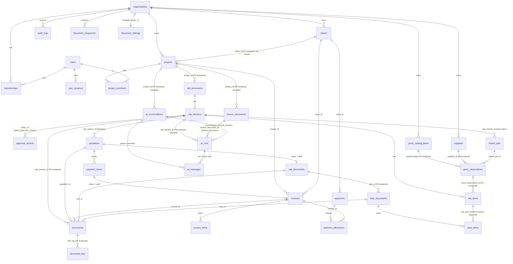

# Skema Database

PostgreSQL 17, dikelola dengan Alembic (`services/api/alembic/versions`). Revisi saat ini:

| Revisi | Isi |
|---|---|
| `0001` | Baseline kosong |
| `0002` | Identitas (organisasi, pengguna, membership, sesi, percobaan login), klien, proyek, anggota proyek, penomoran dokumen, audit log |
| `0003` | RAB: `rab_documents`, `rab_versions`, `rab_items`, `approval_records`; unique `(organization_id, id)` pada `projects` |
| `0004` | Katalog harga: ekstensi `pg_trgm`, `suppliers`, `price_catalog_items` (+ index trigram nama), `price_observations`, `import_jobs`; `rab_items.price_observation_id` |
| `0005` | Dokumen: `document_settings`, `documents` (snapshot JSONB + hash), `document_files` (berkas `bytea`); `import_jobs.rab_version_id` |
| `0006` | Penagihan: `quotations`, `payment_terms`, `invoices`, `invoice_items`, `payments`, `payment_allocations`; `documents.quotation_id/invoice_id` + CHECK jenis dokumen diperluas |

## Konvensi

- PK `UUID` (v4, dibangkitkan aplikasi). Nomor manusiawi (mis. `PRJ-2026-0001`) disimpan terpisah.
- Semua tabel bisnis punya `organization_id`; setiap query service memfilter kolom ini.
- `created_at`/`updated_at` bertipe `timestamptz` (UTC). `audit_logs.created_at` memakai
  `clock_timestamp()` agar urutan tetap benar walau beberapa entri ditulis dalam satu transaksi.
- Uang `NUMERIC(20,2)`, persentase `NUMERIC(5,2)`; tidak pernah `float`.
- Enum disimpan sebagai `VARCHAR(32)` + `CHECK` bernama (`ck_<tabel>_<enum>`), bukan enum native.
- Nama constraint deterministik lewat naming convention (`pk_`, `fk_`, `uq_`, `ck_`, `ix_`).
- Optimistic locking: kolom `version` pada `clients`, `projects`, `suppliers`, `price_catalog_items`
  (SQLAlchemy `version_id_col`).
- Harga satuan `NUMERIC(20,4)`, kuantitas `NUMERIC(18,4)`.

## Relasi



## Tabel

| Tabel | Kegunaan | Catatan integritas |
|---|---|---|
| `organizations` | Perusahaan/tenant + profil (nama legal, NPWP, kontak) | — |
| `users` | Akun global (email unik, hash Argon2id) | `CHECK email = lower(email)` |
| `memberships` | User ↔ organisasi + role | `UNIQUE (organization_id, user_id)`; role via CHECK |
| `user_sessions` | Sesi server-side | Hanya `token_hash`/`csrf_token_hash` (SHA-256); `expires_at`, `last_seen_at`, `revoked_at` |
| `login_attempts` | Throttling login | Index `(email, created_at)`, `(ip_address, created_at)`; tanpa password |
| `clients` | Klien per organisasi | `UNIQUE (organization_id, code)`; `UNIQUE (organization_id, id)` sebagai target FK komposit |
| `projects` | Proyek lintas industri | `UNIQUE (organization_id, number)`; FK komposit `(organization_id, client_id)` → `clients` sehingga proyek tidak bisa menunjuk klien organisasi lain; CHECK tanggal, mata uang ISO, pajak label+tarif berpasangan, tarif 0–100, anggaran ≥ 0 |
| `project_members` | Anggota proyek | PK `(project_id, user_id)`; hapus proyek → cascade |
| `document_sequences` | Penomoran per (org, jenis, tahun) | PK komposit; increment atomik via `INSERT … ON CONFLICT DO UPDATE … RETURNING` |
| `audit_logs` | Jejak aktivitas | Index `(organization_id, created_at)`, `(entity_type, entity_id)`; `changes` JSONB `{field: {from, to}}`, field rahasia dibuang |
| `rab_documents` | Nomor + judul RAB per proyek | `UNIQUE (organization_id, number)`; FK komposit ke `projects` (org sama) |
| `rab_versions` | Revisi RAB: status, pajak, diskon, total tersimpan | `UNIQUE (rab_id, version_no)`; **unique index parsial `uq_rab_versions_one_open`** (maks. satu `draft`/`in_review` per RAB); CHECK diskon konsisten dengan jenisnya, pajak berpasangan, total ≥ 0 dan diskon ≤ subtotal; `lock_version` (optimistic) |
| `rab_items` | Item per versi | Kuantitas `NUMERIC(18,4)` > 0; harga satuan `NUMERIC(20,4)` ≥ 0 atau NULL; `subtotal NUMERIC(20,2)` NULL tepat ketika harga NULL; `row_version` (optimistic); FK komposit ke versi (org sama), hapus versi → cascade |
| `approval_records` | Riwayat keputusan (submit/approve/reject/…): aktor, waktu, from → to, catatan | Append-only; `created_at` = `clock_timestamp()`; generik lewat `entity_type` untuk dokumen terbit nanti |
| `suppliers` | Pemasok sebagai sumber harga | `UNIQUE (organization_id, id)`; index `(organization_id, name)`; `version` |
| `price_catalog_items` | Item katalog (nama, kode, kategori, merek, spesifikasi, satuan, jenis) — tanpa harga | `UNIQUE (organization_id, code)`; GIN trigram `lower(name)`; `version` |
| `price_observations` | Riwayat harga append-only + provenance + status verifikasi (ADR-025) | FK komposit ke item dan supplier (org sama); CHECK `price ≥ 0`, mata uang ISO, `valid_until ≥ COALESCE(valid_from, observed_at)`, **`verified_requires_source`** (terverifikasi ⇒ ada supplier/referensi/URL), `verification_timestamped`; `created_at` = `clock_timestamp()` |
| `import_jobs` | Pratinjau & hasil impor spreadsheet (ADR-027) | `rows`/`warnings`/`result` JSONB; status `previewed → committed \| discarded` |

| `document_settings` | Template dokumen per organisasi (ADR-034) | `UNIQUE (organization_id)`; CHECK warna `#RRGGBB`; `version` |
| `documents` | Dokumen terbit: nomor, status `issued`/`void`, snapshot JSONB + `snapshot_sha256`, total, kunci idempotensi (ADR-030/031) | `UNIQUE (organization_id, number)`, `UNIQUE (organization_id, idempotency_key)`; **unique index parsial `uq_documents_one_active_per_rab_version`**; FK komposit ke `rab_versions` dan `projects`; CHECK `void` ⇔ `voided_at`, dokumen RAB wajib `rab_version_id`, total ≥ 0 |
| `document_files` | Berkas hasil render yang disimpan saat terbit | `UNIQUE (document_id, format)`; CHECK `size_bytes = octet_length(content)`, SHA-256 heksadesimal; konten dimuat hanya saat diunduh |

| `quotations` | Penawaran dari versi RAB disetujui; nilai disalin; status alur review; tanggapan klien (ADR-037) | `UNIQUE (organization_id, number)`; FK komposit ke proyek & versi RAB; CHECK `grand_total = taxable_base + tax_amount`, tanggapan bertimestamp; `version` |
| `payment_terms` | Termin per penawaran (persen/nilai tetap, DPP, pajak, total, jatuh tempo) (ADR-035) | `UNIQUE (quotation_id, position)`; CHECK persen sesuai basis, 0 < persen ≤ 100, `total = amount + tax` |
| `invoices` | Invoice termin/manual, alur review, `amount_paid` | Nomor unik per org (diisi saat terbit); FK komposit ke proyek, klien, penawaran, termin; **unique index parsial `uq_invoices_one_per_payment_term`**; CHECK total konsisten, `0 ≤ amount_paid ≤ grand_total`, terbit/batal wajib nomor + tanggal, jatuh tempo ≥ tanggal terbit; `version` |
| `invoice_items` | Baris invoice | Kuantitas > 0, harga ≥ 0; `amount = round2(qty × harga)` dari modul kalkulasi |
| `payments` | Pembayaran diterima (append-only; batal dengan alasan) (ADR-036) | `amount > 0`; `UNIQUE (organization_id, idempotency_key)`; FK komposit ke klien |
| `payment_allocations` | Bagian pembayaran untuk satu invoice | `UNIQUE (payment_id, invoice_id)`; `amount > 0`; FK komposit ke pembayaran & invoice |

| `spk_documents` | SPK dari penawaran diterima: periode, lokasi, lingkup, ketentuan, penanda tangan (diketik pengguna), nilai kontrak disalin (ADR-038) | Nomor unik per org (diisi saat terbit); FK komposit ke proyek, klien, penawaran; **unique index parsial `uq_spk_documents_one_per_quotation`** (status ≠ void); CHECK periode berurutan, nilai ≥ 0, terbit/batal wajib nomor + tanggal, `void` ⇔ `voided_at`; `version` |
| `bast_documents` | BAST per SPK: jenis sebagian/akhir, tanggal serah terima, lokasi, pihak menyerahkan/menerima (ADR-039) | Nomor unik per org (saat terbit); FK komposit ke SPK; **unique index parsial `uq_bast_documents_one_final_per_spk`** (akhir & ≠ void); CHECK terbit/batal wajib nomor + tanggal serah terima; `version` |
| `bast_items` | Baris serah terima: uraian, volume, satuan, kondisi; opsional menunjuk item kontrak | `UNIQUE (bast_id, position)`; `quantity > 0`; FK komposit ke BAST (cascade); `rab_item_id` FK biasa (organisasi dicek di service — `rab_items` tidak punya unique `(organization_id, id)`) |

| `ai_runs` | Permintaan ke asisten AI lokal: jenis (`rab_draft`, `extract_items`, `extract_document`, `chat_answer`), status, input, `context` (data yang dikirim ke model), hasil tervalidasi, error aman, model, percobaan, durasi, penerapan (ADR-041/043/044) | **Unique index parsial `uq_ai_runs_one_active_per_org`** (queued/running); FK komposit ke versi RAB, dokumen sumber, percakapan (cascade); CHECK `kind_target` (target wajib per jenis), `applied` ⇔ `applied_at`, percobaan 0–100 (dokumen panjang: beberapa panggilan) |
| `source_documents` | File sumber yang diunggah ke proyek (PDF, XLSX, CSV, gambar): nama tampilan, jenis hasil deteksi isi, ukuran, SHA-256, isi (`bytea`, dimuat hanya saat unduh/baca), teks terbaca (`extraction` JSONB, cache) (ADR-043) | `UNIQUE (organization_id, project_id, sha256)` (dedup per proyek); `UNIQUE (organization_id, id)`; FK komposit ke proyek (cascade); CHECK ukuran > 0 dan = `octet_length(content)`, SHA-256 heksadesimal |
| `ai_conversations` | Percakapan chat proyek, privat milik pembuatnya (ADR-044) | `UNIQUE (organization_id, id)`; FK komposit ke proyek (cascade); index `(project_id, created_by_id, updated_at)` |
| `ai_messages` | Pesan pengguna & jawaban asisten: isi, sumber yang dikutip (dengan data yang diberikan ke model), peringatan pemeriksaan, `run_id` | FK komposit ke percakapan (cascade); `run_id` SET NULL; CHECK isi tidak kosong; `created_at` = `clock_timestamp()` agar urutan stabil dalam satu transaksi |

`documents` (migrasi `0007`) juga menampung dokumen `spk` dan `bast` (kolom `spk_id`/`bast_id`,
FK komposit, satu dokumen berlaku per sumber, CHECK sumber per jenis). `document_settings` menambah
`spk_terms` dan `bast_terms`. Volume kumulatif BAST ≤ volume kontrak dijaga di service dengan
penguncian baris SPK (ADR-039), bukan constraint database (lintas baris/tabel).

`import_jobs.kind` membedakan impor katalog (`price_catalog`) dan impor item RAB (`rab_items`, dengan
`rab_version_id`; ikut terhapus bila RAB dihapus).

`rab_items.price_observation_id` (nullable) menunjuk harga katalog yang dipakai (FK komposit
`fk_rab_items_observation_same_org`); harga tetap disalin ke item (ADR-029).

Total pada `rab_versions` adalah turunan dari `app/modules/rab/calculation.py` dan dihitung ulang
setiap mutasi; tidak pernah diisi dari input pengguna.

`projects.attributes` (JSONB) hanya untuk atribut deskriptif khusus jenis proyek (maks. 30 kunci,
nilai skalar). Data yang perlu dihitung, dicari, atau diaudit secara terstruktur harus menjadi kolom
atau tabel sendiri (lihat ADR-018).

## Perintah

```powershell
cd services\api
.\.venv\Scripts\python.exe -m alembic upgrade head
.\.venv\Scripts\python.exe -m alembic check
.\.venv\Scripts\python.exe -m alembic revision --autogenerate -m "pesan"
```

Migrasi hasil autogenerate **wajib ditinjau**: Alembic menggandakan CHECK untuk kolom `Enum`
(lihat komentar di revisi `0002`).
